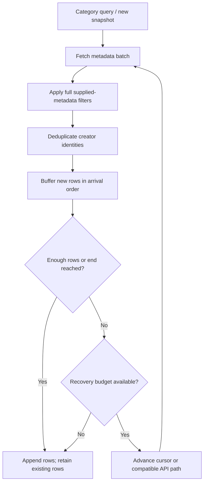

# Stable category pagination

## Problem and scope

Live directories are moving targets. Streams go live/offline and viewer-count ranks change between requests. [Twitch explicitly documents duplicate or missing streams across Get Streams pages.](https://dev.twitch.tv/docs/api/reference#get-streams) Adjacent cursor pages can therefore overlap even when both requests succeed. A transient stream ID alone is also insufficient when a broadcaster reconnects or different APIs describe the same creator differently.

HexStream’s category directory uses an append-only client snapshot. This prevents repeated accepted creators and preserves rows already shown. It does not freeze Twitch’s server or guarantee that every broadcaster active at any point in time can be enumerated.

The implementation lives in [`BrowseSession.kt`](../app/src/main/java/com/github/andreyasadchy/xtra/repository/datasource/BrowseSession.kt), [`GameStreamsDataSource.kt`](../app/src/main/java/com/github/andreyasadchy/xtra/repository/datasource/GameStreamsDataSource.kt), and [`GameStreamsViewModel.kt`](../app/src/main/java/com/github/andreyasadchy/xtra/ui/game/streams/GameStreamsViewModel.kt). Playback/proxy logic is independent.

## Session identity and stable rows

Each new PagingSource owns a session with an identity set, pending unique-row queue, current API path, path-local cursor set and counters. Broadcaster ID is the primary durable identity. Lowercase channel login and stream ID are also retained as aliases. A row matching any known alias is dropped; newly learned aliases are merged even for duplicates. This bridges a row initially missing a broadcaster ID with a later response that contains one.

Accepted row objects are kept in arrival order. Later responses for the same creator do not replace the original row or update its viewer count. There is no continuous live resort. Viewer counts are the values captured when those rows were accepted.

Rows without broadcaster ID can still deduplicate by login or stream ID. A row with none of those identifiers cannot be reliably identified; the client cannot infer a durable identity from a title or thumbnail.

## Batch size, filtering and thin pages

The upstream metadata batch size is **100**. Android Paging uses **30-row pages**, an initial load of **100**, and a prefetch distance of **60** for normal cards or **100** for compact cards. Fetching metadata does not eagerly load all corresponding thumbnails; image loading remains attached to visible/prefetched UI rows.

The session applies content filtering before unique-row acceptance. It buffers accepted rows across responses and requests further pages when duplicates or filters leave too few rows. The UI receives the pending unique rows, rather than raw duplicate-heavy responses.

## Recovery bounds and cursors

| Condition | Behavior |
| --- | --- |
| Adjacent overlap or duplicate-heavy page | Drop known identities, retain new ones, and fetch internally if the target is still thin. |
| Fully repeated page | Count zero progress even though the upstream response is nonempty. |
| Empty page with a new valid cursor | Advance within the same bounded recovery loop. |
| Empty response indicating continuation but no cursor | Try the next compatible API path; never resubmit the previous cursor indefinitely. |
| Repeated cursor | Record it and switch to the next compatible path. |
| Blank final cursor / explicit end | Finish upstream pagination, then drain pending rows. |
| Three consecutive no-progress pages on a path | Switch to the next compatible path, or finish if none remain. |
| Six upstream requests in a load | Return buffered rows; if no rows remain, stop rather than loop indefinitely. |
| API failure | Try the next compatible path. A final-path failure returns a Paging error and keeps pending rows for retry. |
| Cancellation | Propagate cancellation immediately. |

No-progress means **zero accepted unique rows**, including pages where filtering removes everything. Cursor history is local to each API; identity history spans API switches. Cursors are never copied from one API into another.

These bounds may end a heavily filtered or unstable directory early. That is an intentional limit on recovery, not evidence that Twitch has no additional streams. Refresh starts a new browsing session.

## API order and query semantics

The existing priority is **GraphQL query → persisted GraphQL query → eligible Helix**. A Helix path is included only when a Helix token is available, the sort is default/descending viewer count, and there are no selected tag or language filters. Other queries retain only compatible GraphQL paths.

Recovery does not silently clear selected tags, languages or sort to obtain more rows. Filter semantics take precedence over maximizing the directory length.

## Reset and navigation

Manual refresh invalidates the old source. Changing category, sort, selected tag or language creates a fresh query/source and identity state. Ordinary scrolling reuses the session. Back navigation can restore the same cached list while its ViewModel survives; process death or ViewModel recreation starts a new one.

## Diagnostics

Debug builds log a `CategorySnapshot` counter record with:

- Upstream pages requested and items received.
- Unique rows accepted and duplicate rows dropped.
- Repeated cursors and empty pages.
- Recovery requests and API path switches.
- Consecutive no-progress pages.

The logger emits counters only, not cursors, request headers, cookies, tokens or playback URLs. Release builds do not emit this debug counter log.

## Automated coverage

[`BrowseSessionTest.kt`](../app/src/test/java/com/github/andreyasadchy/xtra/repository/datasource/BrowseSessionTest.kt) covers adjacent duplicates, duplicate-heavy pages, fully repeated pages, repeated cursors, empty-then-valid responses, blank final cursors, overlapping API paths, missing broadcaster IDs, a large identity set, bounded no-progress recovery, stable accepted row values, cancellation and retry behavior. These are deterministic fake upstream sequences, not tests dependent on a particular live category.
